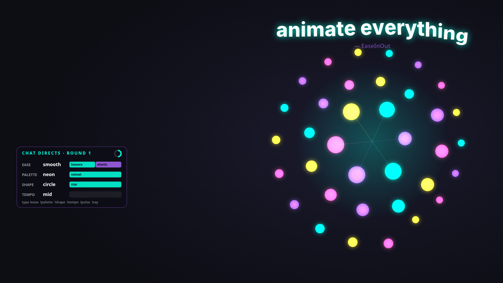
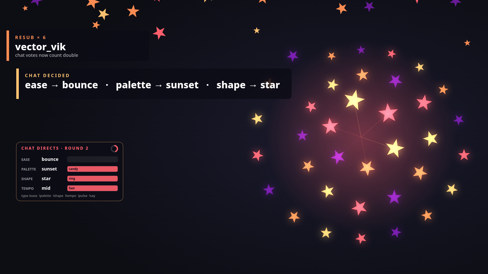

# KEYFRAME — chat directs the motion

> A Twitch overlay where **chat is the motion designer.** Viewers vote on the *easing, palette, shape and tempo*
> of a living animated scene — and every follow, sub, raid, cheer, hype train and channel-point reward
> triggers its own choreographed moment. Built for the **Codex × TwitchCon Hackathon**.




## What it does

| Chat types | Effect |
|---|---|
| `!ease bounce` · `elastic` · `snap` · `back` · `smooth` | the *personality* of all motion (36-shape actor breathing, banners, text) |
| `!palette neon` · `sunset` · `mono` · `candy` · `forest` | staggered colour cross-fade through the rings |
| `!shape circle` · `tri` · `square` · `star` · `ring` | staggered shape morph |
| `!tempo slow` · `mid` · `fast` | global time-scale |
| `!pulse` | radial shock-wave through the actor |
| `!say <text>` | kinetic-typography title, letters animated with the current ease |
| anything else | floats into the kinetic chat feed |

Votes are tallied live in an animated HUD; every **20 s round** the winners are applied with a motion transition
and announced ("CHAT DECIDED: ease → bounce"). Subs/mods count ×2. Chat *heat* (activity + events) speeds up and
brightens the scene.

**Twitch events** (EventSub): follows, subs / resubs, gift subs, cheers, raids, hype trains, and
**channel-point rewards** (name a reward "Change Palette", "Pick the Shape", "Ease Style", "Tempo", or "Chaos").
Every applied change is logged to a **reel** (`/api/reel`) — the stream's choreography as JSON.

## Run it (no Twitch account needed)

```bash
npm install
npm run demo        # scripted 50-second showcase, mock events
npm run mock        # endless random mock chat/events
# open http://localhost:8787/?preview=1   (overlay with dark preview background)
# open http://localhost:8787/dashboard.html (fire follows/subs/raids, type chat as a viewer)
npm test
```

## Run it on a real channel

1. Create an app at <https://dev.twitch.tv/console> → **Client Type: Public** → OAuth redirect `http://localhost` (unused by device flow).
2. `cp .env.example .env` and set `TWITCH_CLIENT_ID`.
3. `npm run auth` → open the printed link, enter the code, approve (scopes: chat, followers, subs, bits, redemptions, hype train).
   Tokens are stored in `.tokens.json` (git-ignored) and refreshed automatically.
4. `npm start` — logs show each EventSub subscription as it succeeds.
5. In OBS add a **Browser Source** → `http://localhost:8787/` → 1920×1080. (Overlay URL params: `?x=0.74&y=0.5&scale=1&hud=0`.)

Secrets are never committed; see `.env.example`.

## Project layout

```
shared/    easing + parameter definitions used by server and overlay
src/       director (votes/rounds/heat), cues, EventSub client, auth, server, mock simulator
public/    overlay (canvas motion scene), dashboard
tests/     node:test suites (17 tests: director, cues, EventSub handshake with a fake Twitch socket, server)
docs/      architecture notes
```

See [docs/ARCHITECTURE.md](docs/ARCHITECTURE.md).

## How Codex was used

_TODO (filled in at submission): Codex session ID, what was generated/reviewed by Codex, and prompts used._
See [docs/CODEX_TASKS.md](docs/CODEX_TASKS.md).

## License

MIT © 2026 Demir
